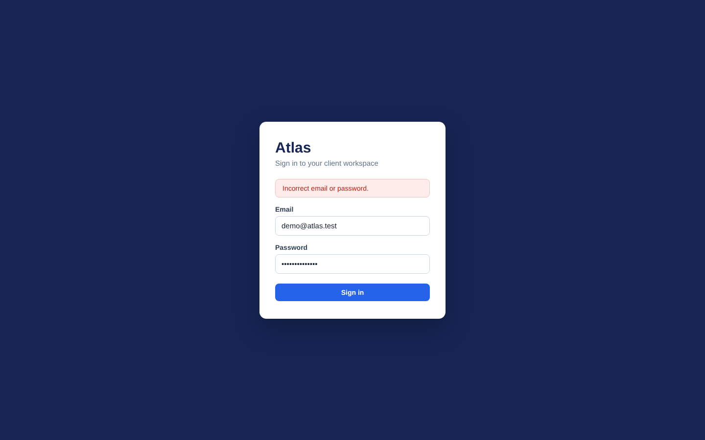
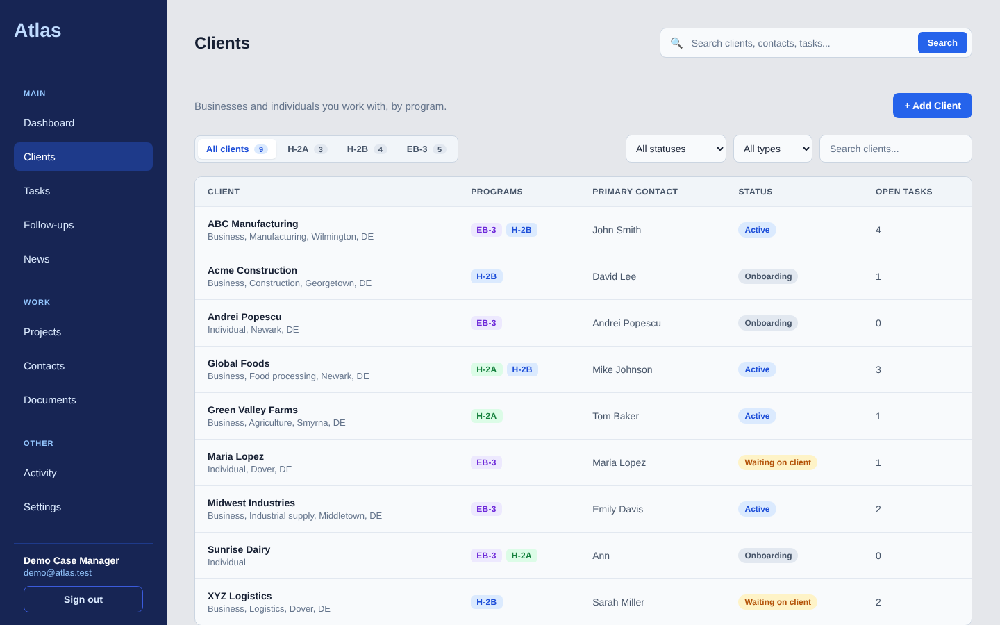
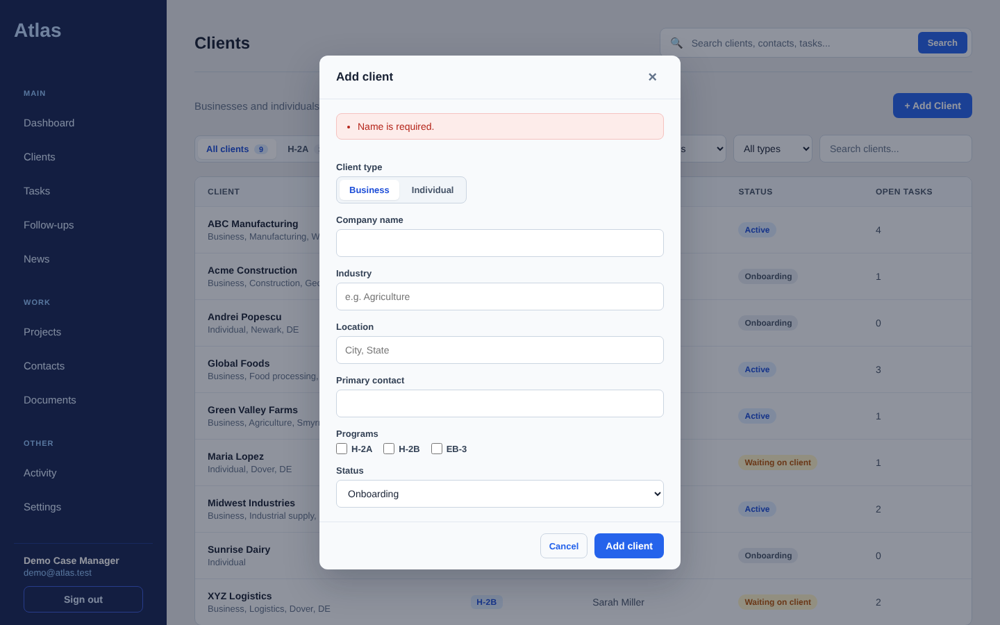
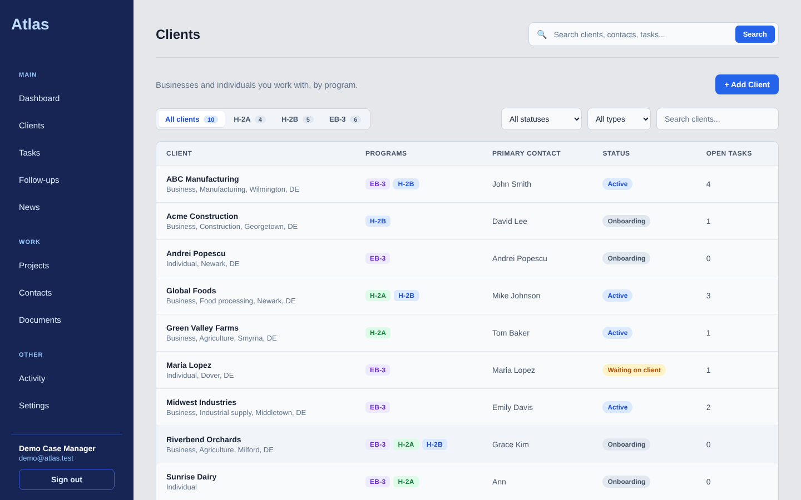

# Atlas

Atlas is a portal for managing visa cases (H-2A, H-2B, EB-3) for businesses and individuals. Clients, programs, contacts, projects, tasks, follow-ups and documents all in one place instead of spreadsheets and emails.

This is the Sprint 1 MVP: login + a clients list that's saved in Postgres, and each client can be in more than one program.

- Live app: https://atlas-pearl-five-58.vercel.app
- API: https://atlas-api-4303.onrender.com/api/health
- Demo login: `demo@atlas.test` / `AtlasDemo2026!`
- Jira: https://ivangopei.atlassian.net/jira/software/projects/ATL/boards/4

Heads up: the API is on Render's free plan so it sleeps after ~15 min. First login after that can take up to a minute, then it's fine.

## Sprint 1

- **ATL-1 Sign in** - email + password, wrong ones show an error. Every page and API route needs you to be logged in (API gives 401 otherwise).
- **ATL-2 Add/manage clients** - add client form saves to the db and shows up in the list right away. Name and type are required, industry is only for businesses.
- **ATL-3 Programs** - a client can be in H-2A, H-2B and EB-3 at the same time. Shows as tags and you can filter by them.

The other pages (dashboard, projects, contacts, follow-ups, documents, activity, news) still use fake data in the browser for now. Those are for sprint 2 and 3.

## Screenshots

Wrong password:



Clients from the database:



Add client validation:



Client saved in 3 programs:



More in `docs/screenshots`.

## Stack

- Frontend: React, TypeScript, Vite, React Router
- Backend: Python, FastAPI, Pydantic
- DB: PostgreSQL (psycopg 3)
- Auth: bcrypt + JWT
- Tests: Vitest, pytest, GitHub Actions
- Hosting: Vercel (frontend), Render (API + db)

## How it's set up

```
React app (Vercel)
   |  /api/*  gets forwarded to Render
   v
FastAPI (Render) -> routes -> schemas (validation) -> repositories (SQL) -> Postgres
```

Frontend (`src/`):
- `pages/` - the UI, forms, showing errors
- `services/` - logic like validation and filtering (`clientService.ts`, `taskService.ts`)
- `api/` - `apiClient.ts`, the only place that calls fetch
- `auth/` - `AuthContext.tsx`, who's logged in
- `data/` - fake data for pages that aren't on the API yet

Backend (`server/app/`):
- `routes/` - endpoints
- `schemas.py` - validation rules (pydantic)
- `security.py` - password hashing, tokens, `get_current_user`
- `repositories.py` - all the SQL for users and clients
- `db.py` - db connection
- `init_db.py` - creates tables + demo data on an empty db
- `db/schema.sql`, `db/seed.sql` - tables and dummy data

### Design patterns

- **Layers** - pages call services, services call the api client. On the server routes call repositories. Makes it easy to test the logic without a browser or db.
- **Repository** (`repositories.py`) - SQL is behind functions like `create_client(conn, client)`, so tests can swap in a fake.
- **Dependency injection** (FastAPI `Depends`) - the login check is added to every protected router in `main.py`, and tests override it.
- **Observer** (`AuthContext.tsx`) - components use `useAuth()` and rerender when you log in/out.
- **Facade** (`apiClient.ts`) - hides fetch, headers, tokens and error parsing from the rest of the app.

### Why I did it this way

- FastAPI + Postgres: pydantic makes validation easy and the db `CHECK` constraints back it up.
- JWT instead of sessions so the API doesn't need to keep state (Render free plan restarts a lot). Tokens last 8 hours.
- Passwords are bcrypt hashed. Login says the same thing for wrong email and wrong password so you can't guess accounts.
- `client_programs` join table so a client can be in any mix of programs (ATL-3).
- Vercel forwards `/api/*` to Render so there's no CORS stuff to deal with.
- Validation happens on both sides. Frontend for quick feedback, server rejects bad data with 422 anyway.
- If the db is down you get a 503 with a short message, not a 500 with a stack trace.

## API

Everything except `/api/health*` and `/api/auth/login` needs `Authorization: Bearer <token>`.

- `GET /api/health` - API is up
- `GET /api/health/db` - db is reachable (503 if not)
- `POST /api/auth/login` - `{email, password}` returns a token + user, 401 if wrong
- `GET /api/auth/me` - current user
- `GET /api/clients` - all clients with programs, contact and open task count
- `GET /api/clients/{id}` - one client (404 if not found)
- `POST /api/clients` - create a client (201, or 422 if invalid)
- `GET /api/tasks`, `/api/projects`, `/api/contacts`, `/api/followups`, `/api/documents` - read only for now

FastAPI docs are at `/docs` when running locally.

## Running locally

You need Node 20+, Python 3.12+ and Postgres 15+.

```bash
git clone https://github.com/Ivangopei/atlas-new.git
cd atlas-new
```

Backend:

```bash
createdb atlas
cd server
python -m venv .venv
source .venv/bin/activate      # windows: .venv\Scripts\activate
pip install -r requirements-dev.txt
cp .env.example .env
# put your DATABASE_URL and a JWT_SECRET in .env
# secret: python -c "import secrets; print(secrets.token_urlsafe(48))"
uvicorn app.main:app --reload  # localhost:8000
```

It creates the tables and demo data by itself the first time. To reset: `python -m app.init_db --reset`.

Frontend (another terminal, repo root):

```bash
npm install
npm run dev   # localhost:5173
```

Log in with `demo@atlas.test` / `AtlasDemo2026!`.

## Using it

1. Log in with the demo account (try a wrong password too)
2. Go to Clients, the list comes from the db
3. Filter with the H-2A / H-2B / EB-3 tabs, status, type or search
4. Click + Add Client, pick business or individual, check some programs and save. It shows up right away and is still there after refresh
5. Try saving with no name to see the errors
6. Sign out at the bottom of the sidebar

## Tests

```bash
npm test                 # frontend, 52 tests
cd server && python -m pytest   # backend, 39 tests
```

GitHub Actions runs lint, both test suites and the build on every PR and push to main.

The logic is in plain functions / pydantic models so it can be tested directly. API tests use FastAPI's `TestClient` with a fake db, so no Postgres needed. I tried to test both the normal case and the common failures for each feature.

- `test_auth.py` - hashing, login (good/bad password, unknown email, email case), 401s, fake and expired tokens
- `test_clients.py` - client validation and `POST /api/clients`
- `test_api.py` - health checks, list routes, db down -> 503
- `clientService.test.ts` - form validation, mapping, filters
- `apiClient.test.ts` - token header, error messages, sign out on 401
- `taskService.test.ts` - task validation, dates, overdue, filters

Also tested by hand locally and on the live site (login, adding clients, refresh, filters, sign out).

## Deployment

- **Vercel** - connected to this repo, deploys on every push to main. `vercel.json` forwards `/api/*` to Render and sends everything else to `index.html` so refreshing `/clients` works.
- **Render** - free Postgres + FastAPI service from `server/`. `DATABASE_URL` and `JWT_SECRET` are env vars (not committed). `render.yaml` has the same setup as a blueprint.

## Troubleshooting

- `DATABASE_URL is not set` / 503 "Database is not configured" - make `server/.env` from `.env.example` and run uvicorn from `server/`
- 503 "Database is unavailable" - postgres isn't running or the url/password is wrong
- `JWT_SECRET is not set` - add it to `.env` and restart
- Login always fails locally - db was made before the users table existed, run `python -m app.init_db --reset` (wipes local data)
- "Could not reach the server" - API isn't running on 8000
- Live site slow on first login - Render is waking up, give it a minute
- `ModuleNotFoundError: app` in pytest - run it from `server/`
- Port in use - `npm run dev -- --port 5174` or `uvicorn app.main:app --port 8001` (then change `vite.config.ts`)

## Limitations / what's next

Right now:
- only one demo account, no sign up or password reset
- can't edit or delete clients yet
- most pages besides clients still use fake data that resets on refresh
- document upload only saves the file name
- Render free plan sleeps and the free db expires after 30 days
- token is in localStorage (httpOnly cookie would be safer)

Next:
- Sprint 2: client detail page (ATL-4), tasks (ATL-5) and contacts (ATL-6) on the db, edit/delete clients
- Sprint 3: follow-ups (ATL-7), real document storage (ATL-8), more tests, better db plan, monitoring
- Later: dashboard (ATL-9), search + activity history (ATL-10), English/Russian switch

## Git workflow

Feature branches -> PR -> main. Vercel and Render both deploy from main.

## License

MIT
